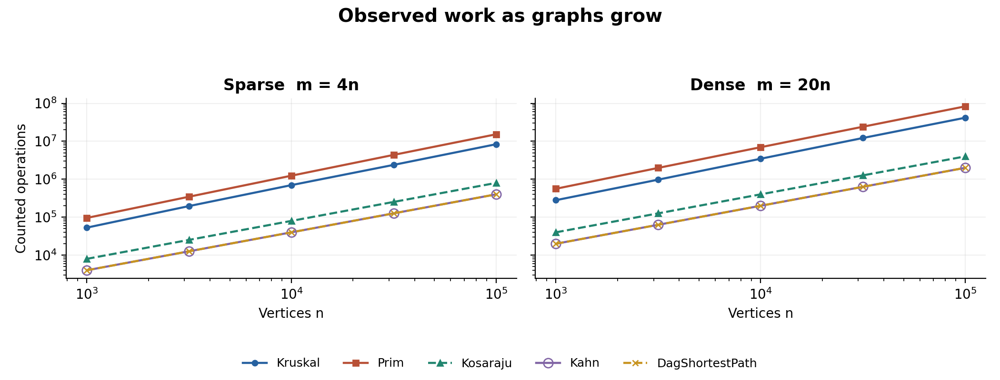
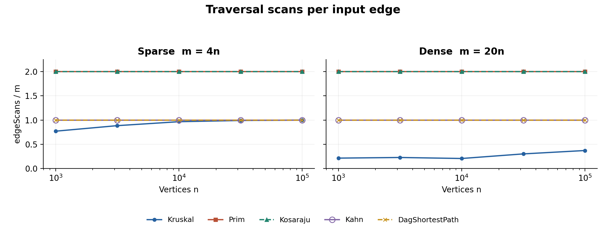
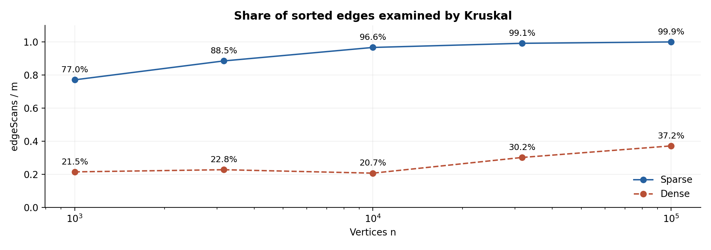

# City Network and Job Scheduler

DAA Assignment 3 | Moldir Amanbek | SE-2521 | 23 October 2026

The project implements one shared graph model, all required algorithms, and both bonus tasks. All 30 reference results match the assignment. The full benchmark contains 50 core rows and 10 Tarjan rows; all 21 JUnit 5 tests passed, including iterative SCC on a 100,000-vertex path with a 256 KiB JVM stack.

## Implementation and complexity

Let V be vertices and E be logical input edges. Graph storage is O(V + E); an undirected edge has two adjacency entries. Space below is additional working space, including returned results but excluding the input graph. log(E + 1) also covers empty graphs.

| Operation | Time | Extra space | Reason |
| --- | --- | --- | --- |
| DSU makeSet | O(V) | O(V) | Initialize parent and size arrays. |
| DSU find / union | O(alpha(V)) amortized | O(1) per call | Size-based union bounds tree height; full iterative path compression flattens visited paths. The DSU owns O(V) storage; one call can take O(log V). |
| Kruskal | O(V + E log(E + 1)) | O(V + E) | Own bottom-up merge sort; each examined edge performs two finds and at most one successful union. |
| Prim with lazy PQ | O(V + E log(E + 1)) | O(V + E) | Each adjacency entry is read once; queued edges, including stale entries, require heap comparisons. |
| Kosaraju | O(V + E) | O(V + E) | Two iterative DFS passes plus a reversed graph; at most V active frames. |
| Kahn | O(V + E) | O(V) | Copy stored in-degrees, queue each vertex once, decrement once per outgoing edge. |
| DAG shortest paths | O(V + E) | O(V) | Topological ordering plus one relaxation pass; long distances and parent pointers. |
| Tarjan bonus | O(V + E) | O(V) | One iterative DFS with discovery indices, low links, and an active-vertex stack. |
| Condensation bonus | O(V + E log(E + 1)) | O(V + E) | Ordered map deduplicates component pairs; the subsequent longest-path pass is O(Vc + Ec). |

## What the counters measure

dsu_ops = find calls + successful unions, including finds made inside union. edge_scans counts the Kruskal selection loop, Prim adjacency entries, the two Kosaraju DFS passes, Kahn outgoing edges, or DAG relaxations. comparisons counts edge-weight comparator calls in sorting and the priority queue; it excludes distance comparisons. max_depth is the largest active DFS frame stack in either SCC pass, with root depth 1.

Graph construction and Kosaraju reversal are not traversal scans. Graph caches in-degrees when inserting edges. DAG timing includes a separate Kahn preprocessing pass, but the DAG row records only its relaxation scans, as requested. Operations in plots means dsu_ops + edge_scans + comparisons; it is a reproducible work proxy, not a count of every CPU instruction.

## Correctness arguments

Cut property. Consider a cut that does not split any already selected tree component. Let e be a minimum-weight edge crossing that cut. If a minimum spanning tree T already contains e, it is safe to keep it. Otherwise, adding e to T creates a cycle, and that cycle contains another edge f crossing the cut. Because weight(e) <= weight(f), replacing f with e preserves connectivity and cannot increase the total weight, so a minimum spanning tree containing e exists. Kruskal uses this rule when its next sorted edge joins two DSU components, while Prim uses the cut between visited and unvisited vertices. Applying the argument independently in each connected component gives a minimum spanning forest, and tied weights may produce different trees with the same optimal total. [1]

Topological induction. Initialize every in-degree-zero vertex at distance 0, which is equivalent to adding a virtual source with zero-weight edges. Every vertex in a finite DAG is reachable from at least one such source. Assume all vertices before v in a valid topological order already have their correct shortest distances. Every incoming edge to v comes from one of those earlier vertices, so its relaxation has already proposed the cost of the best path ending with that edge. Taking the minimum of these proposals therefore establishes the correct distance to v. Relaxing v then prepares the candidates needed by later vertices, completing the induction after one pass. Negative edges do not break the argument because a DAG has no cycles; in a general graph a reachable negative cycle can make distances unbounded below, although Bellman-Ford handles negative edges when no relevant negative cycle exists. [2]

## Which algorithm when

| Situation | Choice and reason |
| --- | --- |
| Sparse undirected graph; edge list | Kruskal: sorting is convenient and DSU rejects cycles; disconnected input naturally produces a forest. |
| Undirected adjacency list | Prim: grows a tree from vertex 0 and restarts at unvisited vertices; useful when adjacency access is already available. |
| Very dense graph, E near V squared | An O(V squared) array/matrix Prim variant can avoid heap costs; the submitted lazy-PQ Prim is not that variant. For the given m = 20n instances, measured counters favor Kruskal. |
| Directed graph; cycles possible | Kosaraju for a clear two-pass SCC decomposition; Tarjan if avoiding the transpose and halving DFS edge scans matters. |
| Dependency scheduling | Kahn provides an order or explicitly reports a cycle; SCCs locate mutually dependent groups. |
| Weighted DAG, including negative edges | Topological shortest-path relaxation; for the critical path, replace minimum with maximum. Dijkstra is not the default for negative weights. |

## Bonus interpretation and validation

Tarjan returns the same partition as Kosaraju, compared through a bijection of component labels rather than numeric IDs. It scans E edges instead of 2E and avoids the transpose. Condensation drops internal edges and keeps the maximum weight among parallel component transitions for longest-path analysis. The critical path is a component-level abstraction; internal cyclic job dependencies still require resolution before a real schedule is feasible. In a DAG, maximizing in topological order is equivalent to minimizing negated weights without negating int values. In a general graph, longest simple path is NP-hard; unrestricted walks can be unbounded with a positive cycle. [2, 3]

Independent checks include 100 random MST comparisons plus exhaustive tiny spanning trees; random SCCs against BFS in both directions up to 200 vertices; 100 negative-weight DAGs against Bellman-Ford; path reconstruction; brute-force longest paths; malformed input; loops, parallel edges, isolated vertices, empty graphs, and 64-bit totals.

## Exact reference agreement

| n | m | MST weight | SCCs | DAG distance sum |
| --- | --- | --- | --- | --- |
| 1,000 | 4,000 | 147,970 | 27 | 396,274 |
| 1,000 | 20,000 | 30,363 | 1 | 252,411 |
| 3,162 | 12,648 | 468,911 | 137 | 1,271,911 |
| 3,162 | 63,240 | 97,589 | 1 | 723,157 |
| 10,000 | 40,000 | 1,486,139 | 373 | 3,941,828 |
| 10,000 | 200,000 | 309,550 | 1 | 2,381,342 |
| 31,623 | 126,492 | 4,715,515 | 1188 | 12,551,891 |
| 31,623 | 632,460 | 968,517 | 1 | 7,376,612 |
| 100,000 | 400,000 | 15,012,094 | 3923 | 40,096,539 |
| 100,000 | 2,000,000 | 3,056,681 | 1 | 23,512,087 |

Both MST algorithms agree with every listed weight and return V - 1 edges. Kahn returns V vertices, and every input edge satisfies pos[u] < pos[v]. All five measured runs reproduce the same result and counters. Any disagreement aborts the benchmark before a new CSV is written.

## Counter divided by complexity formula

The five numeric columns follow n = 1,000; 3,162; 10,000; 31,623; 100,000. K = Kruskal and P = Prim use comparisons / (E log2 E). S = Kosaraju, T = Kahn, and D = DAG relaxation use edgeScans / (V + E).

| Alg. | Density | 1,000 | 3,162 | 10,000 | 31,623 | 100,000 |
| --- | --- | --- | --- | --- | --- | --- |
| K | sparse | 0.896 | 0.928 | 0.940 | 0.926 | 0.949 |
| K | dense | 0.935 | 0.922 | 0.946 | 0.953 | 0.942 |
| P | sparse | 1.831 | 1.866 | 1.900 | 1.930 | 1.946 |
| P | dense | 1.826 | 1.849 | 1.868 | 1.880 | 1.892 |
| S | sparse | 1.600 | 1.600 | 1.600 | 1.600 | 1.600 |
| S | dense | 1.905 | 1.905 | 1.905 | 1.905 | 1.905 |
| T | sparse | 0.800 | 0.800 | 0.800 | 0.800 | 0.800 |
| T | dense | 0.952 | 0.952 | 0.952 | 0.952 | 0.952 |
| D | sparse | 0.800 | 0.800 | 0.800 | 0.800 | 0.800 |
| D | dense | 0.952 | 0.952 | 0.952 | 0.952 | 0.952 |

Traversal ratios are exactly constant: Kosaraju is 1.600 or 1.905, and Kahn/DAG relaxation is 0.800 or 0.952. Comparator ratios stay in narrow bands, consistent with E log E work; finite samples support rather than prove the asymptotic bounds. DSU call counts alone cannot experimentally establish alpha(V), because internal parent-pointer traversals are not counted.

Kruskal dsu_ops / E, sparse: 1.791, 2.019, 2.182, 2.232, 2.248. Dense: 0.480, 0.506, 0.465, 0.654, 0.794. These are bounded, but not constant: the early-stop position changes with the graph. Exactly dsu_ops = 2 * edgeScans + V - 1 on these connected inputs.

Scope resolution: the detailed benchmark section specifies ten size/density pairs and 50 rows; this is followed despite the deliverables section saying "four generated graphs". Each pair uses three graph kinds, with a fresh Random(42) for each generator call.

## Measured work and linear traversal scans

Figure 1. Log-log work curves, with one line per algorithm and density. Kahn and DAG relaxation overlap because each counts exactly E scans. The two MST curves include weight comparisons.

At both density settings, traversal work grows in direct proportion to n because m = cn. The assignment calls m = 20n dense, but both benchmark families remain asymptotically linear in n; this is not an E = Theta(V squared) experiment.

Figure 2. Scans per logical edge. Prim and Kosaraju overlap at 2; Kahn and DAG relaxation overlap at 1. Kruskal is below 1 when early termination avoids scanning the sorted suffix.

Prim scans both adjacency entries of every undirected edge, even though each useful crossing edge enters the queue only once. Kosaraju scans each directed edge once in each DFS pass. Kahn and DAG relaxation inspect each outgoing edge once; the DAG function also performs an unreported Kahn preprocessing scan to obtain its order.

The flat scan ratios verify traversal work independently of laptop speed. Prim still has non-linear comparison work because its priority queue holds candidate edges. Kruskal sorts all E edges even if its selection loop stops early, so a small examined fraction does not remove the sorting cost.

## Kruskal early stopping and slope check

Figure 3. Fraction of sorted edges examined before one DSU component remains. All edges are still included in sorting.

Sparse inputs examine 77.1% to 99.9% of edges; dense inputs examine 20.7% to 37.2%. The denser family offers more cheap connections before expensive edges are reached. The submitted lazy Prim always scans 2E adjacency entries and performs more weight comparisons on these data; this is implementation-specific evidence, not a universal claim about every Prim variant.

| Algorithm | Scan sparse | Scan dense | Work sparse | Work dense |
| --- | --- | --- | --- | --- |
| Kruskal | 1.055 | 1.119 | 1.096 | 1.088 |
| Prim | 1.000 | 1.000 | 1.102 | 1.085 |
| Kosaraju | 1.000 | 1.000 | 1.000 | 1.000 |
| Kahn | 1.000 | 1.000 | 1.000 | 1.000 |
| DagShortestPath | 1.000 | 1.000 | 1.000 | 1.000 |

Slopes are ordinary least-squares fits of ln(counter) against ln(n). Traversals give 1.000 exactly. Kruskal scan slopes are 1.055 and 1.119, while its total counted-work slopes are 1.096 and 1.088. The scan slope changes because the examined fraction changes; the E log E factor belongs to sorting comparisons. Conflating the two would misinterpret the assignment wording.

## Time and reproducibility

Times are medians of five runs after one warm-up. Environment: Java: 17.0.20; OS: Linux amd64; Max heap bytes: 2147483648. At n = 100,000 and m = 2,000,000: Kruskal 1,755.6 ms, Prim 2,765.3 ms, Kosaraju 998.3 ms, Kahn 300.8 ms, DagShortestPath 380.8 ms. Small cases show JVM warm-up and timing noise. Hardware, allocation, garbage collection, and background load affect elapsed time, so conclusions use counters. Result values and deterministic loop counts reproduce; priority-queue comparator counts can depend on the JDK implementation.

Run bash scripts/reproduce.sh after installing the Python requirements. It builds, runs JUnit, benchmarks all ten pairs, and regenerates plots, analysis, and this report. Git contains main, the five required feature branches, and release tag v1.0. AI assistance in implementation, testing, and report preparation is acknowledged in README.md.

## References

[1] Sedgewick and Wayne, Algorithms, 4.3 Minimum Spanning Trees: https://algs4.cs.princeton.edu/43mst/
[2] Sedgewick and Wayne, Algorithms, 4.4 Shortest Paths: https://algs4.cs.princeton.edu/44sp/
[3] Sedgewick and Wayne, Algorithms, 4.2 Directed Graphs: https://algs4.cs.princeton.edu/42digraph/
[4] Taubakabyl Nurlybek, DAA Assignment 3 Graphs, supplied specification, pp. 1-7.
